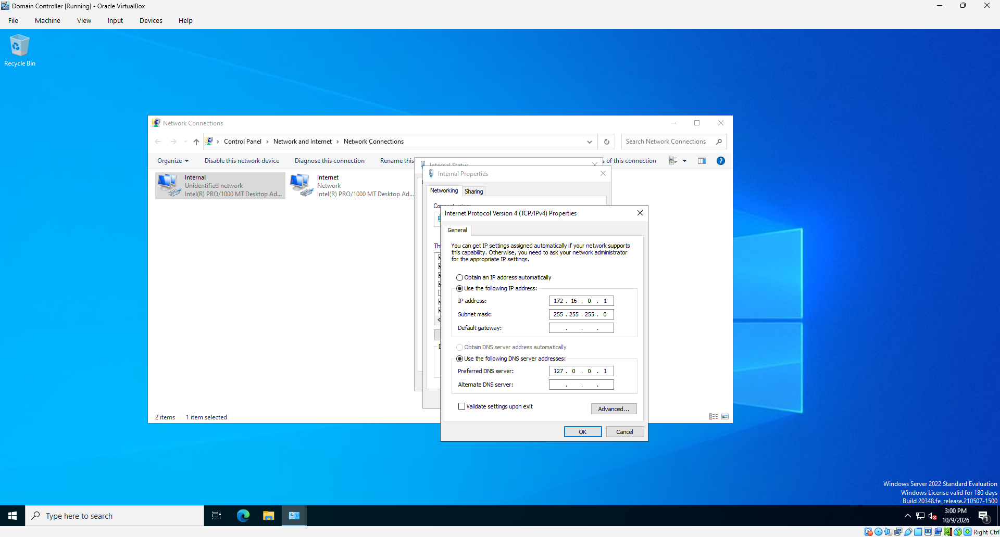
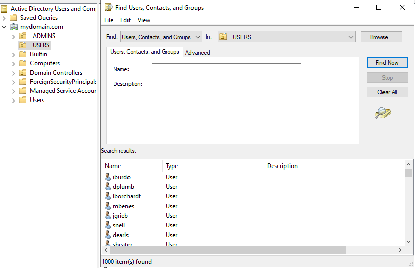
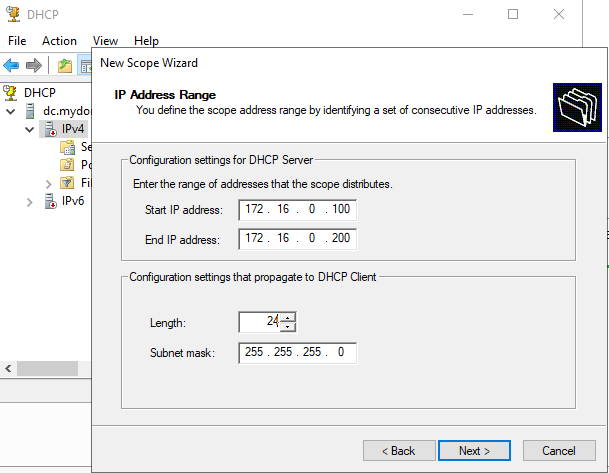
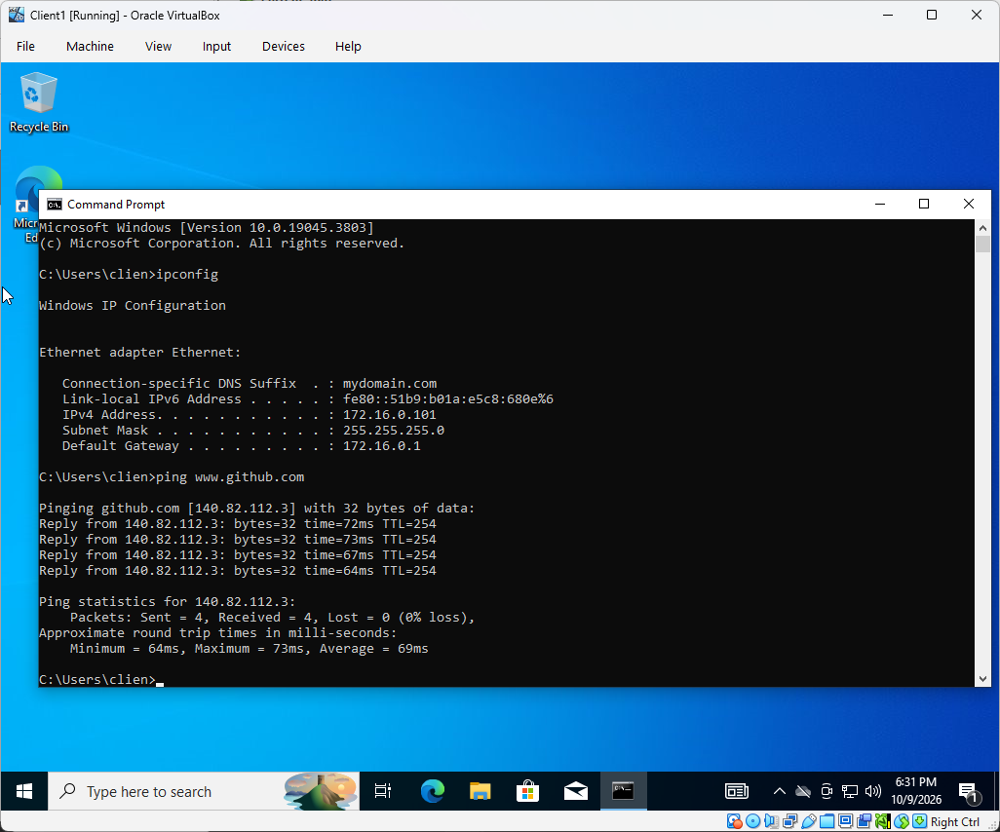
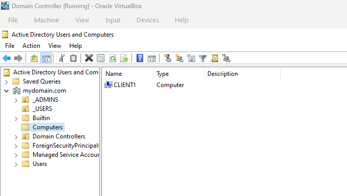
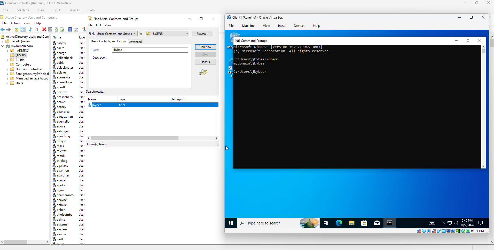

# Active Directory Home Lab

## Overview

I built a two-VM Active Directory lab in Oracle VirtualBox to practice Windows Server administration, account provisioning, and domain connectivity. The environment includes a Windows Server 2022 domain controller and a Windows 10 client joined to `mydomain.com`.

I configured AD DS, DNS, DHCP, and routing, used an existing PowerShell script to populate the directory, and verified that a domain user could sign in to the client. This gave me a working environment for connecting server configuration with what an endpoint actually receives and uses.

## Lab Environment

| Component | Configuration |
| --- | --- |
| Hypervisor | Oracle VirtualBox |
| Domain controller | `DC` — Windows Server 2022 Standard Evaluation, Desktop Experience |
| Client | `CLIENT1` — Windows 10 |
| Domain | `mydomain.com` |
| Virtual networking | DC: NAT + Internal Network; client: Internal Network (`intnet`) |
| Internal subnet | `172.16.0.0/24`; DC: `172.16.0.1` |
| Server roles | AD DS, DNS, DHCP, Routing and Remote Access (RRAS) |
| Administration | Server Manager, AD Users and Computers, DHCP console, PowerShell |

## Implementation

### 1. Configure the virtual network

I gave the DC two network adapters and renamed them **Internet** and **Internal**. The Internet adapter uses VirtualBox NAT; the Internal adapter connects to `intnet`, the same virtual network used by CLIENT1.

The Internal adapter initially showed a `169.254.x.x` address. I assigned it the static address `172.16.0.1/24` and set its preferred DNS server to `127.0.0.1`, pointing back to the DC's own DNS service. I left the internal default gateway blank; the DC's outbound route uses its Internet adapter.

*Internal adapter: 172.16.0.1/24, loopback DNS, and no default gateway.*

### 2. Create the domain and user accounts

I installed Active Directory Domain Services and promoted DC into a new forest named `mydomain.com`. The server also runs DNS. In Active Directory Users and Computers, I created a separate administrative account in the `_ADMINS` organizational unit.

For bulk provisioning, I ran Josh Madakor's `1_CREATE_USERS.ps1`. It reads names from `names.txt`, builds usernames from the first initial and last name, and creates accounts in `_USERS`. My directory search returned 1,000 items. I also verified that the `jbybee` account existed before using it on the client.

*The _USERS search displays user objects and reports 1,000 items found.*

### 3. Configure routing and DHCP

I configured RRAS for NAT and selected the Internet interface, shown as `10.0.2.15`, for outbound traffic. This lets CLIENT1 reach the internet through the DC while connected to the internal virtual network.

I installed DHCP and created a scope from `172.16.0.100` through `172.16.0.200`, using the subnet mask `255.255.255.0`. The scope's router option supplies `172.16.0.1` as the clients' default gateway. Combining these roles on one server keeps this practice lab compact.

*The DHCP scope distributes addresses within 172.16.0.100–172.16.0.200/24.*

## Validation

On CLIENT1, `ipconfig` showed `172.16.0.101`, the expected subnet mask, and gateway `172.16.0.1`. The DHCP console also recorded a lease for that client. Running `ping www.github.com` resolved the hostname and returned four replies with zero packet loss, demonstrating external name resolution and ICMP connectivity.

*CLIENT1 has the expected network settings and receives four replies from github.com.*

I joined CLIENT1 to `mydomain.com` and checked its computer object in Active Directory. I did not capture the join dialog, but the resulting object is shown below.

*CLIENT1 appears in the domain's Computers container.*

Finally, I signed in to CLIENT1 as `jbybee`. Running `whoami` returned `mydomain\jbybee`, confirming the session used a domain account.

*The client session identity matches the jbybee account shown in Active Directory.*

## Key Takeaways

- Connecting DHCP leases, endpoint addressing, and RRAS settings helped me follow traffic through the lab.
- Creating OUs and accounts gave me practice with both manual administration and scripted provisioning.
- Checking the computer object and signed-in identity helped me validate the result beyond the setup wizards.

## References

- [Josh Madakor — Active Directory home lab tutorial](https://www.youtube.com/watch?v=MHsI8hJmggI)
- [Josh Madakor — 1_CREATE_USERS.ps1](https://github.com/joshmadakor1/AD_PS/blob/master/1_CREATE_USERS.ps1)
